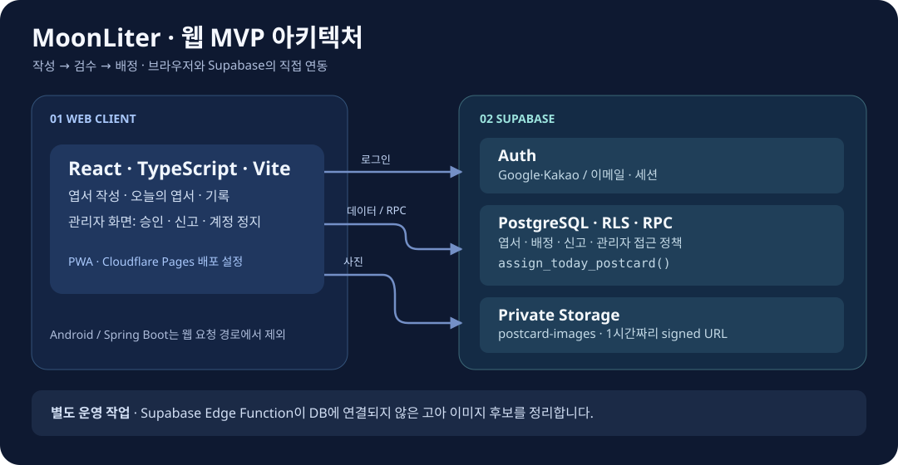

# 문라이터 (MoonLiter)

사진 한 장과 짧은 문장으로 익명의 누군가에게 마음을 건네는 웹 엽서 서비스입니다. 로그인으로 남용을 줄이되, 받은 화면에서는 작성자의 계정 정보를 보여주지 않습니다.

## 웹 UI 시연

[](docs/media/moonliter-ui.mp4)

[MP4로 전체 화면 보기](docs/media/moonliter-ui.mp4) · 로컬에서 실행한 실제 React 화면입니다. 테스트 세션과 샘플 사진을 사용했으며, 입력·사진 미리보기·선택 취소만 시연합니다. 운영 로그인, 저장·배정은 이 영상의 범위가 아닙니다.

## 구현한 흐름

1. **작성:** Google·Kakao 혹은 이메일로 로그인한 사용자가 사진 한 장과 최대 500자의 문장을 작성합니다. 이미지는 전용 비공개 버킷에, 엽서 레코드는 검수 대기 상태로 저장됩니다.
2. **검수:** 관리자가 엽서를 승인하거나 반려합니다. 신고 처리, 숨김, 사용자 정지도 관리자 화면에서 처리할 수 있습니다.
3. **수신:** 오늘의 엽서 배정 RPC가 승인된 후보만 확인해 배정합니다. 수신 이미지는 공개 URL 대신 유효기간이 있는 signed URL로 불러옵니다. 작성·수신 기록을 별도로 확인할 수 있습니다.

## 웹 MVP 아키텍처



- **React 19 · TypeScript · Vite · PWA:** `frontend/`의 웹 화면과 Supabase 연동. Cloudflare Pages 배포 설정은 [운영 문서](docs/operations.md)에 있습니다.
- **Supabase Auth · PostgreSQL · Storage:** 인증, 엽서·배정·신고 데이터, 접근 정책과 RPC는 [마이그레이션](supabase/migrations/)에, 웹 호출 계약은 [API 문서](docs/api.md)에 있습니다.
- **Edge Function:** [고아 이미지 정리](supabase/functions/cleanup-orphan-postcard-images/index.ts)는 브라우저 요청과 별도의 운영 작업입니다.
- `android/`와 `backend/` (Spring Boot)는 저장소에 있지만 현재 웹 MVP 요청 경로가 아닙니다.

## 로컬 실행

Node.js/npm과 별도 테스트용 Supabase 프로젝트가 필요합니다. `supabase/migrations/`의 SQL을 순서대로 적용하고 이메일 인증을 설정합니다. Google·Kakao는 필요할 때만 별도로 설정합니다.

```bash
cd frontend
npm ci
cp .env.example .env.local
# .env.local: VITE_SUPABASE_URL, VITE_SUPABASE_ANON_KEY 설정
npm run dev
```

브라우저에는 Supabase 공개 anon 키만 사용합니다. 운영용 service-role 키를 프론트 환경 변수에 넣지 않습니다. 전체 절차는 [프론트엔드 실행 안내](frontend/README.md)와 [운영 문서](docs/operations.md)를 참고하세요.
